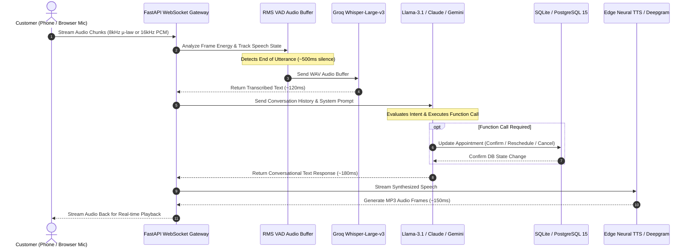

# 🎙️ Vocalis AI — Autonomous Voice Agent Platform

<div align="center">

[](https://fastapi.tiangolo.com)
[](https://react.dev)
[](https://vitejs.dev)
[](https://tailwindcss.com)
[](https://python.org)
[](https://www.postgresql.org)
[](https://redis.io)
[](https://www.docker.com)
[](https://opensource.org/licenses/MIT)

**A full-stack, production-grade AI voice agent platform for appointment-based businesses to eliminate no-shows with sub-second, natural spoken conversation.**

[Features](#-key-features) • [Architecture](#-system-architecture) • [Quickstart](#-quickstart--installation) • [Docker Setup](#-docker-compose-deployment) • [Voice Sandbox](#-web-voice-sandbox-simulator) • [API Spec](#-api--websocket-reference) • [Testing](#-testing-suite)

</div>

---

## 📖 Overview

**Vocalis AI** is an intelligent, end-to-end voice automation platform built for healthcare clinics, dental offices, salons, spas, and automotive service centers. Missed appointments ("no-shows") cost local businesses tens of thousands of dollars annually and waste hours of staff time spent manually making reminder calls.

Vocalis AI autonomously places outbound conversational voice calls to confirm, reschedule, or cancel upcoming appointments—updating appointment databases in real time via LLM tool-calling and escalating complex requests to human receptionists.

### ✨ Zero-Cost & Developer-First
To enable instant local development, evaluation, and portfolio demonstration:
* **Runs 100% free / keyless out-of-the-box**: Uses Microsoft Edge Neural TTS (completely keyless and natural) and Groq Whisper + Llama 3.1 (free developer tier), with graceful fallback to simulated mock conversational intelligence.
* **Built-in Web Sandbox Call Simulator**: Test live bidirectional voice conversations directly in your browser using your microphone with real-time neon spectrogram visualization—no Twilio account or phone number required!

---

## 🚀 Key Features

### 🎙️ Blazing-Fast Conversational Voice Pipeline
* **Speech-to-Text (STT)**: Utterance-based recording using a local RMS Voice Activity Detector (VAD) coupled with Groq's Whisper-large-v3 API (sub-150ms transcription).
* **LLM Orchestration**: Multi-provider failover supporting **Groq (Llama-3.1-70B)**, **Google Gemini (1.5 Flash)**, **Anthropic Claude 3.5 Sonnet**, and a built-in rule engine. Handles live database scheduling modifications via dynamic function calling:
  * `confirm_appointment()`
  * `reschedule_appointment(new_time)`
  * `cancel_appointment(reason)`
  * `escalate_to_human()`
* **Text-to-Speech (TTS)**: Microsoft Edge Neural TTS voice integration—completely free, keyless, and ultra-natural with tunable speech pacing (`-10%` to `+20%`) and customizable voice personas (Aria, Guy, Jenny, Steffan, Sonia, etc.).

### 📊 Visual ROI Analytics & Latency Telemetry
* **Interactive ROI Simulator**: Custom booking value slider (`$50 - $500`) calculating custom annual recovered revenue and saved administrative hours based on industry baseline no-show rates (18%).
* **Real-time Latency Waterfall**: Granular telemetry tracking turn-by-turn STT, LLM inference, TTS synthesis, and total turnaround time.
* **Outcome & Status Visualizations**: Interactive Recharts analytics breakdown (Confirmed, Rescheduled, Cancelled, Escalated).

### 🧪 Web Voice Sandbox Call Simulator
* Test the voice agent directly inside your browser with zero telephony overhead.
* Downsamples microphone audio to 16kHz PCM, streams chunks over WebSockets, and plays synthesized Edge TTS MP3 frames natively.
* Real-time neon Web Audio API spectrogram visualizer and downloadable session audio (`.webm`).
* Dual-mode input: Speak directly via microphone or type via fallback console input bar.

### 📅 Calendar & Outbound Campaign Management
* **Live RFC 5545 iCalendar Feed**: Dedicated live URL subscription endpoint (`/api/calendar/{business_id}/feed.ics`) compatible with Google Calendar, Apple Calendar, and Microsoft Outlook.
* **Batch Outbound Reminder Campaigns**: One-click dispatch or cron trigger to dial all pending appointments due in the next 24 hours.
* **CSV Bulk Importer**: Upload patient/client appointment lists in seconds with automated header parsing.
* **Reschedule Slot Manager**: Business owners can configure and open specific time slots for automated rescheduling.

### 🔍 Call Intelligence & Sentiment Analysis
* Automatic sentiment categorization (`Positive`, `Neutral`, `Urgent`, `Frustrated`).
* Intent tagging (`Confirmation`, `Reschedule`, `Cancellation`, `Human Escalation`).
* Full turn-by-turn conversation transcript modal viewer.
* Instant CSV call history and analytics exporter (`/api/calls/export.csv`).

### ⚙️ Persona & Behavior Customization
* Customize Agent Name (e.g., "Sarah"), custom spoken greetings, and business context/FAQs.
* Calibrate Voice Activity Detection (VAD) Sensitivity (`low`, `normal`, `high`).
* Configure external webhook URL callbacks for CRM/EHR integration and automated SMS confirmations.

---

## 🏗️ System Architecture

### Conversational Audio & Pipeline Flow



### Full-Stack Architecture Layout

```
                                  ┌───────────────────────────────┐
                                  │      React 19 + Vite UI       │
                                  │   (Tailwind v4, Lucide Icons, │
                                  │    Recharts, Web Audio VAD)   │
                                  └──────────────┬────────────────┘
                                                 │
                                 HTTP REST / WSS │ (Port 5000 / 80)
                                                 ▼
┌──────────────────────────────────────────────────────────────────────────────────────────────────┐
│                                      FastAPI Backend Server                                      │
│                                                                                                  │
│   ├── /api/auth          - JWT Authentication & Bcrypt Cryptography                              │
│   ├── /api/appointments  - CRUD, CSV Upload & 1-Click Trigger Engine                             │
│   ├── /api/campaigns     - Batch 24-Hour Outbound Reminder Dispatcher                            │
│   ├── /api/calendar      - RFC 5545 iCalendar (.ics) Live Subscription Feed                     │
│   ├── /api/calls         - Call Transcripts, Sentiment, Latency Metrics & CSV Export             │
│   ├── /api/settings      - Voice Persona, Speech Speed, FAQs & Webhook Callbacks                 │
│   ├── /api/billing       - Stripe Checkout & Subscription Plan Status                            │
│   └── /twilio-stream     - Bidirectional Low-Latency Audio Streaming Pipeline                   │
└──────────────────────────┬───────────────────────────────┬───────────────────────────────────────┘
                           │                               │
              ┌────────────▼────────────┐     ┌────────────▼────────────┐
              │  PostgreSQL 15 / SQLite │     │   Redis 7 Event Store   │
              │  (Appointments, Calls,  │     │   (Session Caching &    │
              │    Businesses, Slots)   │     │    Pub/Sub Channels)    │
              └─────────────────────────┘     └─────────────────────────┘
```

---

## 📂 Project Structure

```
vocalis-ai/
├── backend/
│   ├── app/
│   │   ├── __init__.py
│   │   ├── audio_utils.py       # G.711 µ-law transcoders, RMS VAD detector & PCM converters
│   │   ├── auth.py              # JWT token generation, verification & Bcrypt password hashing
│   │   ├── db.py                # Dual DB connector (SQLite fallback + PostgreSQL asyncpg)
│   │   ├── main.py              # FastAPI application, REST endpoints & WebSocket routing
│   │   ├── pipeline.py          # Real-time conversational pipeline (STT ↔ LLM ↔ TTS)
│   │   └── redis_client.py      # Redis session state management & Pub/Sub event dispatcher
│   ├── tests/
│   │   ├── __init__.py
│   │   ├── test_api.py          # End-to-end asynchronous REST API lifecycle tests
│   │   ├── test_audio.py        # Audio conversion, RMS energy & VAD state machine tests
│   │   └── test_auth.py         # Authentication, token generation & verification tests
│   ├── Dockerfile               # Multi-stage Python backend container image
│   ├── requirements.txt         # Production Python dependencies
│   └── pytest.ini               # Asyncio test configuration
│
├── frontend/
│   ├── src/
│   │   ├── pages/
│   │   │   ├── Appointments.jsx # Appointment management, CSV import, iCal feed & campaign trigger
│   │   │   ├── Billing.jsx      # Pricing tiers, annual discount toggle & checkout
│   │   │   ├── CallLogs.jsx     # Turn-by-turn transcripts, sentiment badges & CSV exporter
│   │   │   ├── Dashboard.jsx    # Visual ROI slider, Recharts metrics & latency waterfall
│   │   │   ├── Login.jsx        # Business login and registration portal
│   │   │   ├── Sandbox.jsx      # Web mic voice simulator & neon spectrogram visualizer
│   │   │   └── Settings.jsx     # Assistant persona, voice preview, speed & VAD tuning
│   │   ├── App.jsx              # App layout, persistent navigation & authentication state
│   │   ├── index.css            # Glassmorphism cyber dark theme styling
│   │   └── main.jsx             # React DOM root entry
│   ├── Dockerfile               # Multi-stage Nginx production container image
│   ├── package.json             # Frontend dependencies (React 19, Tailwind v4, Lucide, Recharts)
│   └── vite.config.ts           # Vite bundler configuration
│
├── docker-compose.yml           # PostgreSQL 15, Redis 7, Backend & Frontend full-stack definition
├── PRODUCT_SPEC.md              # Detailed SaaS and product specification handbook
└── README.md                    # Project documentation
```

---

## 🛠️ Quickstart & Installation

### Prerequisites
* **Python 3.10+**
* **Node.js 18+** & **npm**

---

### Step 1: Environment Configuration

Navigate to `/backend` and create your `.env` file from `.env.example`:

```bash
cd backend
cp .env.example .env
```

Configure your environment variables:

```env
# Server Configuration
PORT=5000
JWT_SECRET=vocalis-production-jwt-secret-key-98765

# Free LLM & Speech-to-Text (Recommended - https://console.groq.com)
GROQ_API_KEY=gsk_your_groq_api_key

# Optional Alternative LLMs
GEMINI_API_KEY=
ANTHROPIC_API_KEY=
XAI_API_KEY=

# Optional: Real Cellular Phone Calls (Twilio)
TWILIO_ACCOUNT_SID=
TWILIO_AUTH_TOKEN=
TWILIO_PHONE_NUMBER=

# Optional: Dedicated PostgreSQL / Redis (Defaults to embedded SQLite if empty)
DATABASE_URL=
REDIS_URL=
```

> **Note:** If no API keys are provided, Vocalis AI automatically operates in **simulated zero-cost mock mode**, allowing full feature exploration and frontend testing without external API dependencies.

---

### Step 2: Backend Setup & Testing

1. Create and activate a Python virtual environment:

```bash
cd backend
python -m venv venv

# On Windows:
.\venv\Scripts\activate

# On macOS/Linux:
source venv/bin/activate
```

2. Install backend dependencies:

```bash
pip install -r requirements.txt
```

3. Run the automated test suite to ensure system integrity:

```bash
pytest -v
```

4. Start the FastAPI development server:

```bash
uvicorn app.main:app --port 5000 --reload
```
*The server boots on `http://localhost:5000` and automatically bootstraps the database schema.*

---

### Step 3: Frontend Setup

Open a new terminal window:

```bash
cd frontend
npm install
npm run dev
```

Open `http://localhost:5173` in your browser.

---

## 🐳 Docker Compose Deployment

Run the complete multi-container stack (PostgreSQL 15, Redis 7, FastAPI Backend, and Nginx React Frontend) with a single command:

```bash
# Build and launch all containers
docker-compose up --build -d

# View real-time logs
docker-compose logs -f
```

* **Frontend UI**: `http://localhost` (Port 80)
* **Backend API**: `http://localhost:5000`
* **PostgreSQL**: `localhost:5432`
* **Redis**: `localhost:6379`

To stop the containers:
```bash
docker-compose down
```

---

## 🎙️ Web Voice Sandbox Simulator

Test the conversational AI assistant in real time without needing a phone number:

1. **Sign Up / Sign In**: Register a new account on the dashboard.
2. **Add an Appointment**: Go to the **Appointments** tab and add a test appointment (e.g., *Customer: "Alice"*, *Phone: "+15551234567"*, *Time: Tomorrow at 2:00 PM*).
3. **Open Live Sandbox**: Navigate to **Live Sandbox** in the sidebar.
4. **Select Customer**: Choose `Alice` from the appointment selector.
5. **Choose Input Mode**:
   * **Voice Mode**: Speak into your microphone. The built-in RMS VAD and neon spectrogram will visualize your speech in real time.
   * **Text Mode (Fallback)**: Type responses in the console input bar and hit Enter.
6. **Start Simulated Call**: Click **Start Simulated Call**.
7. **Interact with the AI**: The virtual assistant will introduce itself. Speak naturally to:
   * **Confirm**: *"Yes, I will be there tomorrow at 2:00 PM."*
   * **Reschedule**: *"I can't make it tomorrow. Do you have anything open next week?"*
   * **Cancel**: *"I need to cancel my appointment due to a schedule conflict."*
   * **Escalate**: *"I need to speak to the doctor directly about my prescription."*
8. **Analyze Results**: Hang up to download the session audio (`.webm`) or inspect the **Call History** tab to view turn-by-turn transcripts, sentiment tags, and latency metrics.

---

## 📡 API & WebSocket Reference

### REST Endpoints

| Method | Endpoint | Description | Auth Required |
| :--- | :--- | :--- | :---: |
| `POST` | `/api/auth/register` | Register a new business account | No |
| `POST` | `/api/auth/login` | Authenticate and obtain JWT token | No |
| `GET` | `/api/auth/me` | Fetch authenticated business profile | Yes |
| `GET` | `/api/appointments` | List all scheduled appointments | Yes |
| `POST` | `/api/appointments` | Create a new appointment | Yes |
| `POST` | `/api/appointments/upload` | Bulk import appointments from CSV text | Yes |
| `DELETE` | `/api/appointments/{id}` | Delete an appointment record | Yes |
| `POST` | `/api/appointments/{id}/trigger` | Dispatch outbound voice call for appointment | Yes |
| `POST` | `/api/campaigns/dispatch-reminders` | Batch trigger reminder calls for all pending appointments | Yes |
| `GET` | `/api/calendar/{business_id}/feed.ics` | Live RFC 5545 iCalendar subscription feed | No (Token) |
| `GET` | `/api/slots` | List available reschedule time slots | Yes |
| `POST` | `/api/slots` | Add an available reschedule time slot | Yes |
| `DELETE` | `/api/slots/{id}` | Remove an available reschedule time slot | Yes |
| `GET` | `/api/calls` | Fetch full call history with transcripts & latencies | Yes |
| `GET` | `/api/calls/export.csv` | Download complete call history as CSV report | Yes |
| `GET` | `/api/stats` | Retrieve ROI metrics, status counts & latency stats | Yes |
| `GET` | `/api/settings` | Retrieve voice persona and assistant settings | Yes |
| `PUT` | `/api/settings` | Update voice persona, speech speed, FAQs & VAD | Yes |
| `GET` | `/api/billing/status` | Get current subscription tier and plan status | Yes |
| `POST` | `/api/billing/checkout` | Create Stripe checkout session or mock upgrade | Yes |
| `POST` | `/api/twilio/voice` | Twilio Voice Webhook (TwiML Voice XML generator) | No |

### WebSocket Endpoints

| Endpoint | Protocol | Description |
| :--- | :--- | :--- |
| `/twilio-stream?appointmentId={id}&callId={id}` | WSS | Twilio Media Stream bidirectional audio exchange (8kHz µ-law) |
| `/twilio-stream?appointmentId={id}&callId={id}&sandbox=true` | WSS | Web Sandbox microphone stream & TTS playback (16kHz PCM / MP3) |

---

## 🧪 Testing Suite

Vocalis AI includes an automated asynchronous test suite covering API lifecycles, audio transcoders, VAD state machines, and authentication security.

Execute the test suite with pytest:

```bash
cd backend
pytest -v
```

### Test Coverage Highlights
* **`test_api.py`**: Full registration, login, appointment creation, CSV bulk import, slot booking, stats generation, and settings updates.
* **`test_audio.py`**: G.711 µ-law to PCM16 transcoders, RMS energy calculation, and Voice Activity Detection (VAD) speech state transitions.
* **`test_auth.py`**: Bcrypt password hashing, verification, JWT token creation, and expiration validation.

---

## 💎 SaaS Monetization & Pricing Tiers

| Tier | Price | Included Calls | Voice Engine | Key Features |
| :--- | :---: | :---: | :--- | :--- |
| **Free (Sandbox)** | **$0** / mo | Unlimited Sandbox | Edge Neural | Web mic sandbox, ROI simulator, full dashboard |
| **Starter** | **$29** / mo | 100 calls / mo | Edge Neural | Outbound automated calling, SMS notifications |
| **Professional** | **$79** / mo | 500 calls / mo | Ultra-Premium | Real-time iCal sync, custom persona & FAQs |
| **Enterprise** | **$199** / mo | Unlimited | Ultra-Premium | Multi-location support, custom EHR/CRM webhooks |

---

## 🤝 Contributing

Contributions, issues, and feature requests are welcome!
1. Fork the project repository.
2. Create your feature branch (`git checkout -b feature/AmazingFeature`).
3. Commit your changes (`git commit -m 'Add AmazingFeature'`).
4. Push to the branch (`git push origin feature/AmazingFeature`).
5. Open a Pull Request.

---

## 📄 License

Distributed under the **MIT License**. See `LICENSE` for more information.
